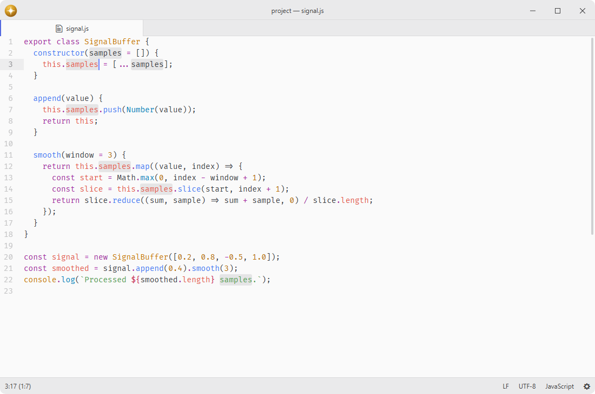

# highlight-selected

Highlight all occurrences of the selected text.

## Features

- **Automatic highlighting**: highlights all matching occurrences when text is selected.
- **Occurrence navigation**: jump to the next or previous highlighted occurrence.
- **Customizable style**: override highlight appearance via stylesheet.
- **Scrollbar markers**: shows the highlighted occurrences on the scrollbar and minimap via the marker hub.



## Installation

To install `highlight-selected` search for it in the Install pane of the Lumine settings, or run the command `lumine --install lumine-code/highlight-selected`.

## Commands

Commands available in `lumine-workspace`:

- `highlight-selected:toggle`: enable or disable highlighting.

Commands available in `lumine-text-editor:not([mini])`:

- `highlight-selected:go-to-next`: select the next highlighted occurrence,
- `highlight-selected:go-to-previous`: select the previous highlighted occurrence.

## Customization

The style can be adjusted according to user preferences in the `styles.css` file, e.g. change highlight style:

```css
lumine-text-editor .highlights {
  .highlight-selected .region {
    border: 1px solid var(--syntax-result-marker-color);
    background-color: var(--syntax-result-marker-color-selected);
    border-radius: 3px;
  }
}
```

## Services

- [`highlight-selected`](docs/highlight-selected.md): provided to observe native marker changes per editor through `onDidChangeMarkers` and read the highlighted occurrences.
- `marker.layer`: provided to draw the highlighted occurrences on the editor's overview maps (scrollbar, minimap).

## Contributing

Got ideas to make this package better, found a bug, or want to help add new features? Just drop your thoughts on GitHub. Any feedback is welcome!
